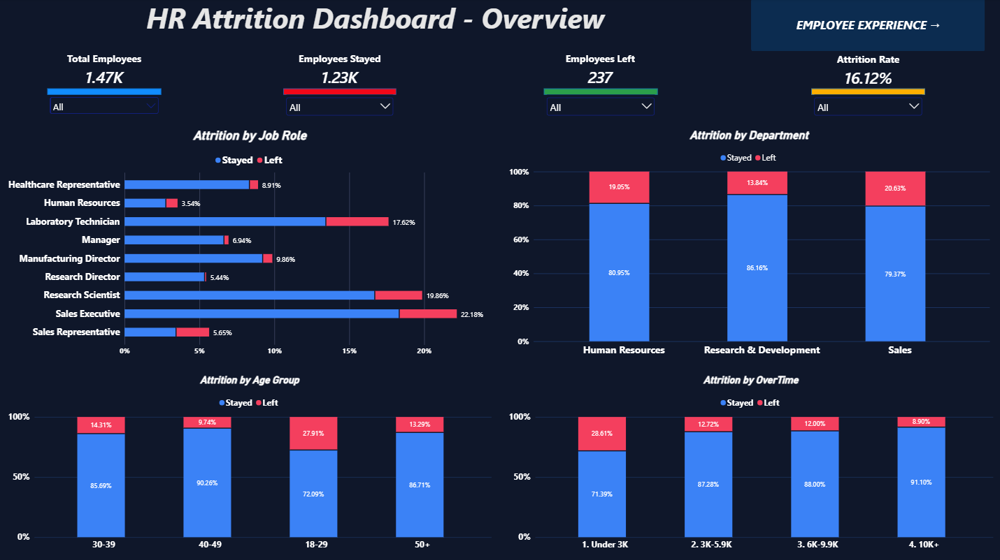
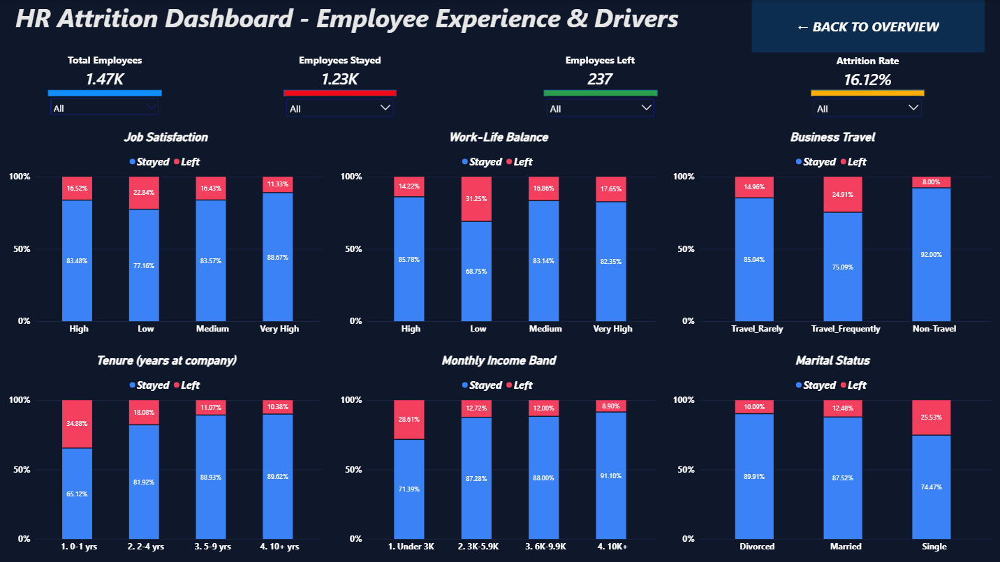

# HR Attrition Analysis

## Project Overview

This project analyzes employee attrition to understand workforce trends, explore factors associated with employee turnover, and provide data-driven insights that can support HR decision-making.

The project uses **Microsoft Excel, SQL Server, Python, and Power BI** across an end-to-end workflow covering data exploration, KPI calculations, analytical querying, visualization, and dashboard reporting.

## Business Objectives

- Measure employee attrition and workforce retention.
- Compare attrition across departments, job roles, and employee age groups.
- Explore attrition patterns related to overtime, job satisfaction, income, and tenure.
- Present key HR metrics and findings through dashboards.
- Translate analysis results into practical questions and recommendations for HR teams.

## Dataset

- **Dataset:** IBM HR Analytics Employee Attrition & Performance
- **Employees:** 1,470
- **Features:** 35
- **Target variable:** `Attrition`

The dataset includes employee demographics, job characteristics, compensation, satisfaction measures, overtime, and employment history.

## Tools & Technologies

| Tool | Purpose |
|---|---|
| Microsoft Excel | Data exploration, PivotTables, KPIs, slicers, and dashboard development |
| SQL Server | Data querying, aggregations, KPI calculations, and attrition analysis |
| Python | Data review, analysis, and export of summary tables and charts |
| Pandas | Data manipulation and analysis |
| Matplotlib | Data visualization |
| Power BI | Interactive dashboards and reporting |

## Project Workflow

### 1. Excel Analysis

- Explored employee data and summarized workforce metrics.
- Built PivotTables to compare attrition across employee groups.
- Developed KPI summaries and dashboard views.
- Used slicers to support interactive exploration.

**Workbook:** `HR_Attrition_Dashboard.xlsx`

### 2. SQL Analysis

- Queried the HR dataset using SQL Server.
- Calculated workforce and attrition KPIs.
- Compared attrition across departments, job roles, overtime, and other employee attributes.
- Used aggregations and analytical queries to investigate patterns.

**SQL script:** `HR_Attrition_Analysis.sql`

### 3. Python Analysis

- Loaded and reviewed the HR dataset with Pandas.
- Examined data quality and summarized key metrics.
- Analyzed attrition across employee attributes.
- Exported summary tables and visualizations for review.

**Analysis notebook/script:** See the files inside `py/`.

**Output folder:** `py/output/`

### 4. Power BI Dashboards

Two dashboard views summarize the analysis.

#### Dashboard 1: Overview



Provides a high-level view of workforce metrics and employee attrition.

#### Dashboard 2: Employee Experience



Explores employee experience indicators and patterns associated with attrition.

**Power BI file:** `Power_BI_Dashboard.pbix`

## Key Performance Indicators

| KPI | Result |
|---|---:|
| Total Employees | 1,470 |
| Employees Who Left | 237 |
| Active Employees | 1,233 |
| Overall Attrition Rate | 16.12% |

The attrition rate is calculated as employees who left divided by total employees.

## Key Findings

The following findings summarize observed differences in attrition rates across employee groups:

### 1. Overtime

| Group | Attrition Rate |
|---|---:|
| Employees with overtime | 30.53% |
| Employees without overtime | 10.44% |

The attrition rate was higher among employees recorded as working overtime. This is an association in the dataset and does not, by itself, prove that overtime caused employees to leave.

### 2. Department

| Department | Attrition Rate |
|---|---:|
| Sales | 20.63% |
| Human Resources | 19.05% |
| Research & Development | 13.84% |

Sales had the highest attrition rate among these departments, followed by Human Resources.

### 3. Age Group

Employees aged 18–25 had an attrition rate of **35.77%**, the highest among the age groups summarized in the analysis.

### 4. Job Satisfaction

| Job Satisfaction | Attrition Rate |
|---|---:|
| Low | 22.84% |
| Very High | 11.33% |

The group with low job satisfaction had a higher attrition rate than the group with very high job satisfaction.

### 5. Tenure

| Years at Company | Attrition Rate |
|---|---:|
| 0–2 years | 29.82% |
| 21+ years | 12.12% |

Employees with shorter tenure showed a higher attrition rate than employees with 21 or more years at the company.

## Business Recommendations

Based on these observed patterns, HR teams could:

- Investigate overtime practices and workload distribution.
- Review retention challenges in Sales and Human Resources.
- Examine onboarding, development, and support for newer employees.
- Monitor employee satisfaction and work-life balance.
- Track attrition KPIs regularly to evaluate retention initiatives.

These are areas for further investigation, not proof of direct causation. Recommendations should be assessed alongside business context and additional evidence.

## Project Structure

```text
HR_Attrition_Analysis
├── README.md
├── Power_BI_Dashboard.pbix
├── HR_Attrition_Dashboard.xlsx
├── HR_Attrition_Analysis.sql
├── py/
│   └── output/
└── images/
    ├── page1_Overview.png
    └── page2_Employee_Experience.png

## Conclusion

This project demonstrates an end-to-end HR analytics workflow using Excel, SQL Server, Python, and Power BI. It combines KPI development, group comparisons, data analysis, and dashboard reporting to turn employee data into insights that can inform further HR investigation and retention planning.

**Skills Demonstrated:** Data Cleaning and Review · Exploratory Data Analysis · SQL Querying · KPI Development · Data Visualization · Dashboard Design · Business Analysis
